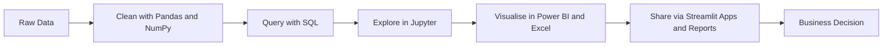

<div align="center">

<h1>Rupak Kumar</h1>

<a href="https://git.io/typing-svg">
  
</a>

<br/>

<a href="www.linkedin.com/in/rupak-kumar-1483abc"></a>
<a href="https://leetcode.com/u/Rupak1483/"></a>
<a href="mailto:rupaksingh8975@gmail.com"></a>


</div>

---

## Profile as a Query

```sql
SELECT
    name,
    role,
    primary_tools,
    focus
FROM   analysts
WHERE  username = 'Rupaksingh17';
```

## About Me

```python
class DataAnalyst:
    def __init__(self):
        self.name = "Rupak Kumar"
        self.role = "Data Analyst"
        self.languages = ["C++", "Python", "SQL"]
        self.libraries = ["Pandas", "NumPy"]
        self.bi_tools = ["Power BI", "Excel", "Streamlit"]
        self.environment = ["Jupyter", "VS Code", "Git", "GitHub", "Codex"]
        self.practice = "Daily problem solving on LeetCode using C++"

    def approach(self):
        return [
            "Understand the business question",
            "Clean and validate the data",
            "Explore patterns and test assumptions",
            "Build dashboards and reports",
            "Communicate findings clearly",
        ]

    def currently_improving(self):
        return ["Advanced SQL", "Statistical analysis", "Data storytelling"]
```

---

## How I Work



---

## Skill Proficiency (self-assessed)

```text
Python         ████████████████░░░░   80%
SQL            ███████████████░░░░░   75%
Excel          ████████████████░░░░   80%
Power BI       ██████████████░░░░░░   70%
Pandas         ████████████████░░░░   80%
NumPy          ██████████████░░░░░░   70%
Streamlit      ████████████░░░░░░░░   60%
C++            ██████████████░░░░░░   70%
```

---

## Tech Stack

<div align="center">

<h4>Languages</h4>


<br/>

<h4>Data Analysis</h4>


<br/>

<h4>Visualisation and Apps</h4>


<br/>

<h4>Tools</h4>


</div>

---

## Analyst Toolkit in Action

```python
import pandas as pd
import numpy as np

df = pd.read_csv("sales_data.csv")

df = (
    df.drop_duplicates()
      .assign(order_date=lambda d: pd.to_datetime(d["order_date"]))
      .dropna(subset=["revenue"])
)

monthly = (
    df.groupby(df["order_date"].dt.to_period("M"))["revenue"]
      .agg(total="sum", average="mean", orders="count")
      .reset_index()
)

monthly["growth_pct"] = monthly["total"].pct_change().mul(100).round(2)
print(monthly.tail())
```

---

## GitHub Activity

<div align="center">


<br/>


<br/>

<h4>LeetCode</h4>

<a href="https://leetcode.com/u/Rupak1483/"></a>


<br/><br/>

<table align="center">
  <tr>
    <th>Level</th>
    <th>Strongest Topics</th>
  </tr>
  <tr>
    <td>Advanced</td>
    <td>Dynamic Programming, Divide and Conquer, Backtracking</td>
  </tr>
  <tr>
    <td>Intermediate</td>
    <td>Math, Database, Binary Search</td>
  </tr>
  <tr>
    <td>Fundamental</td>
    <td>Array, String, Sorting</td>
  </tr>
</table>

</div>

---

## Currently

| Status | Details |
|--------|---------|
| Learning | Advanced SQL, statistics for data analysis |
| Building | Dashboards in Power BI and data apps in Streamlit |
| Practising | Data structures and algorithms in C++ on LeetCode |
| Open to | Data analyst roles, internships and collaboration |

---

## Contact

```text
Email     : rupaksingh8975@gmail.com
LinkedIn  : linkedin.com/in/rupak-kumar-38431b26b
LeetCode  : leetcode.com/u/Rupak1483
GitHub    : github.com/Rupaksingh17
```

<div align="center">
<sub>Data tells a story. I make sure it is heard.</sub>
</div>
